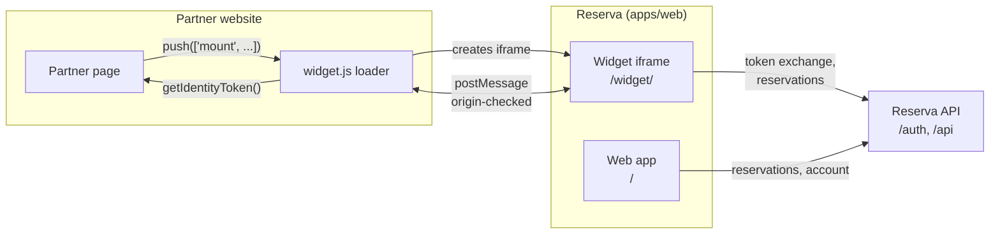

# Reserva frontend

Reserva is an online booking platform. This repository contains:

- the **Reserva web app**, where users find businesses and book appointments,
- the **booking widget**, which partner websites embed to let their visitors book through Reserva,
- a **demo partner site** that embeds the widget the same way a real partner does.

## Embedding the widget

The widget shows a location's available time slots inside an `<iframe>` on your page. A small public loader
script, `/widget.js`, creates the iframe. Your page never receives Reserva's application code or tokens.

Minimal integration:

```html
<div id="reserva-widget"></div>
<script>
  window.ReservaWidget = window.ReservaWidget || [];
  window.ReservaWidget.push([
    'mount',
    '#reserva-widget',
    {
      clientId: '<public client application id>',
      locationId: '<location id>',
      getIdentityToken: () => myAuth.getIdentityToken(), // string | null (null = guest)
    },
  ]);
</script>
<script async src="https://<reserva origin>/widget.js"></script>
```

| Option                 | Required | Description                                                                                                                                   |
| ---------------------- | -------- | --------------------------------------------------------------------------------------------------------------------------------------------- |
| `clientId`             | yes      | Public ID of your client application. Not a secret.                                                                                           |
| `locationId`           | yes      | Location to book. It must be in your scope and approved by the business.                                                                      |
| `getIdentityToken`     | yes      | Returns the signed-in user's token, or `null` for a guest. May return a Promise.                                                              |
| `identityTokenType`    | no       | `'id_token'` (default) or `'jwt'` for a token signed by your backend.                                                                         |
| `theme`                | no       | `'light'`, `'dark'` or `'auto'` (default `'auto'`).                                                                                           |
| `locale`               | no       | `'sr'` or `'en'` (default `'sr'`).                                                                                                            |
| `onReservationCreated` | no       | Called with `{ id, status, startTime, endTime, locationName }`.                                                                               |
| `onUnavailable`        | no       | Called with `{ reason }`: `LOCATION_OUT_OF_SCOPE`, `CONSENT_NOT_APPROVED` or `PARTNER_DISABLED`. Show a fallback, for example a phone number. |

Call `window.ReservaWidget.push(['refreshIdentity'])` after every sign-in and sign-out on your site.

**Identifying your users.** There are two ways to do it:

- **Path 1: OIDC ID token.** If your users sign in with a trusted OIDC provider such as Google, pass its ID token
  through `getIdentityToken`. Reserva needs no backend from you.
- **Path 2: partner-signed assertion.** If you have your own login, your backend signs a short-lived JWT about the
  user with a key you registered with Reserva. Set `identityTokenType: 'jwt'`.

Full reference: [docs/widget.md](docs/widget.md). Step-by-step guide with key registration, claims and security
notes: [docs/partner-integration.md](docs/partner-integration.md). A working example is in
[apps/demo-partner](apps/demo-partner/README.md), which is live at https://demo-business.bojanlab.com.

## Architecture



The loader and the iframe exchange `postMessage` events and check origins on both sides. The iframe is sandboxed.
More detail is in [docs/architecture.md](docs/architecture.md).

## Apps and packages

| Name                                     | Purpose                                                                                         | Dev command                     | Port |
| ---------------------------------------- | ----------------------------------------------------------------------------------------------- | ------------------------------- | ---- |
| `apps/web` (`@fe/web`)                   | Reserva web app. Its build also contains the widget (`/widget/`) and the loader (`/widget.js`). | `yarn dev`                      | 5173 |
| `apps/widget` (`@fe/widget`)             | Widget iframe app and the `widget.js` loader. Built into `apps/web/dist`.                       | `yarn workspace @fe/widget dev` | 5174 |
| `apps/demo-partner` (`@fe/demo-partner`) | Demo partner site. Embeds the widget through the public loader only.                            | `yarn dev:demo-partner`         | 5175 |

The shared code lives in `modules/`: `domain` (entities and interfaces), `application` (use cases),
`infrastructure` (HTTP and repository adapters) and `ui` (React). Dependencies point toward `domain`. See
[docs/architecture.md](docs/architecture.md).

## Quick start

Requirements: Node 22 and Yarn 1 (classic).

```bash
yarn install --frozen-lockfile
cp .env.example .env         # set the VITE_* values for your Reserva backend
yarn dev                     # Reserva web app on http://localhost:5173
```

The local `.env.example` expects the Reserva backend on `localhost` (auth on port 8081, resource service on 8080).
Each app and its environment variables are described in [docs/development.md](docs/development.md).

## Testing

- `yarn lint`: ESLint, with zero warnings allowed.
- `yarn test --run`: unit and component tests (Vitest). Without `--run`, Vitest stays in watch mode.
- `yarn test:coverage`: tests with coverage.
- `yarn build`: type-check (`tsc -b`), then the web app and the widget.

### E2E tests

The end-to-end suite is Playwright, in [`e2e/`](e2e). It covers the web app, the widget and the demo partner
site. It runs in GitHub Actions (`.github/workflows/e2e.yml`) against a Docker Compose stack
(`compose.e2e.yml`) that starts the backend services, a test OIDC issuer and a mail catcher.

Locally you can type-check the suite and list its tests:

```bash
yarn --cwd e2e typecheck
yarn --cwd e2e test:list
```

The setup, environment variables and projects are described in [docs/e2e.md](docs/e2e.md).

## Deployment

- **Staging** (`reserva.<BASE_DOMAIN>`): every push to `main` builds the image from the root `Dockerfile` and
  deploys it to a self-hosted host with Docker Compose and Traefik.
- **Demo partner** (`demo-business.<BASE_DOMAIN>`): a push to `main` that changes `apps/demo-partner/` builds
  its own image and deploys it the same way.

Build-time (`VITE_*`) and runtime settings, the workflows and the health checks are described in
[docs/deployment.md](docs/deployment.md).

## Documentation

| Document                                                   | Contents                                                                        |
| ---------------------------------------------------------- | ------------------------------------------------------------------------------- |
| [docs/widget.md](docs/widget.md)                           | Widget reference: options, commands, events, styling, security, troubleshooting |
| [docs/partner-integration.md](docs/partner-integration.md) | Partner guide: identity paths 1 and 2, key registration, claims, security       |
| [docs/architecture.md](docs/architecture.md)               | Monorepo layout, layers, composition root, widget protocol                      |
| [docs/development.md](docs/development.md)                 | Local setup, dev servers, environment variables, scripts                        |
| [docs/e2e.md](docs/e2e.md)                                 | Playwright suite, projects, environment variables, CI                           |
| [docs/deployment.md](docs/deployment.md)                   | Staging and demo deployment, Docker images, Traefik                             |
| [apps/demo-partner/README.md](apps/demo-partner/README.md) | The demo partner site                                                           |

## Contributing

Open an issue to discuss a change, then send a pull request. Before you submit, run `yarn lint`, `yarn test --run`
and `yarn build`. Keep user-visible text in the i18next resources, not in JSX, and make interactive elements
reachable by role and name, so that the E2E tests can find them.

## License

Licensed under the Apache License, Version 2.0. See [LICENSE](LICENSE).
