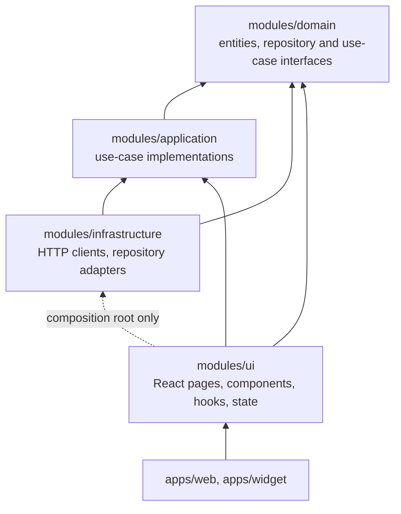

# Architecture

This repository is a Yarn 1 workspace. It holds the Reserva web application, the embeddable booking widget,
a demo partner site and the end-to-end tests. The application code follows a Clean Architecture split into four
packages under `modules/`.

## Repository layout

```
apps/
  web/              @fe/web          Vite app: the Reserva UI, served at /. Build output also contains /widget/ and /widget.js
  widget/           @fe/widget       Widget iframe app (/widget/) and the widget.js loader
  demo-partner/     @fe/demo-partner Static demo partner site. Imports no @fe/* package
modules/
  domain/           @fe/domain           Entities, repository and use-case interfaces. No dependencies
  application/      @fe/application      Use-case implementations
  infrastructure/   @fe/infrastructure   HTTP clients and repository adapters
  ui/               @fe/ui               React pages, components, hooks, routing and state
e2e/                @fe/e2e          Playwright tests and demo seed
```

Each workspace package has its own `package.json`. Packages are consumed from source: each `exports` entry
points at `src/index.ts`, so there is no per-package build step and no path aliases.

## Layers

Dependencies point inward, toward `@fe/domain`:



| Package          | May import                      | Must not import                                                                           |
| ---------------- | ------------------------------- | ----------------------------------------------------------------------------------------- |
| `domain`         | nothing                         | React, browser APIs, axios or fetch, any other `@fe/*` package                            |
| `application`    | `@fe/domain`                    | React, browser APIs, axios or fetch, `@fe/infrastructure`, `@fe/ui`                       |
| `infrastructure` | `@fe/domain`, `@fe/application` | React, `@fe/ui`, business decisions                                                       |
| `ui`             | `@fe/domain`, `@fe/application` | `@fe/infrastructure` (except the composition root), direct axios or fetch, business logic |

ESLint enforces these rules with `no-restricted-imports` in `eslint.config.js`.

## Composition root

`modules/ui/src/app/container/index.ts` is the only file in `@fe/ui` that imports `@fe/infrastructure`. It
creates the concrete HTTP clients, repository adapters and use-case instances. Everything else in `ui` takes its
dependencies from there. To add a new dependency, wire it in the container and import it from there.

## How the apps use the packages

- **`apps/web`** renders `App` from `@fe/ui`. Its Vite config resolves the workspace packages from source.
- **`apps/widget`** has two entry points. The iframe app (`/widget/`) renders `WidgetApp` from `@fe/ui`. The loader
  (`/widget.js`) is a separate IIFE bundle without React, which imports only the protocol helpers from `@fe/domain`.
  Its build output goes into `apps/web/dist`, so one image serves everything.
- **`apps/demo-partner`** is deliberately not a consumer of the packages. It embeds the widget only through the
  public loader, the same way a real partner does.

## Widget protocol

The loader and the iframe talk through `postMessage`. The protocol version is sent as `v` (currently `1`). Every
message has a `type`:

| Direction       | Type                          | Purpose                                                                 |
| --------------- | ----------------------------- | ----------------------------------------------------------------------- |
| iframe → loader | `reserva:ready`               | The app has started.                                                    |
| iframe → loader | `reserva:need-identity`       | The app needs the user's identity. The loader calls `getIdentityToken`. |
| loader → iframe | `reserva:identity`            | The identity token (or `null`) and its `tokenType`.                     |
| iframe → loader | `reserva:resize`              | New content height. The loader sets the iframe height.                  |
| iframe → loader | `reserva:reservation-created` | A reservation was created. The loader calls `onReservationCreated`.     |
| iframe → loader | `reserva:unavailable`         | The widget cannot book here. The loader calls `onUnavailable`.          |

Both sides check `event.origin` and the source window before they parse a message. The types live in
`modules/domain/src/entities/WidgetMessage.ts`.

## Build outputs

| Command                           | Output                                                                              |
| --------------------------------- | ----------------------------------------------------------------------------------- |
| `yarn workspace @fe/web build`    | `apps/web/dist`: the application                                                    |
| `yarn workspace @fe/widget build` | `apps/web/dist/widget/` (the iframe app) and `apps/web/dist/widget.js` (the loader) |
| `yarn build` (root)               | `tsc -b`, then both of the above                                                    |
| `yarn build:demo-partner`         | `apps/demo-partner/dist`                                                            |

The widget build must run after the web build, because it writes into `apps/web/dist`.
