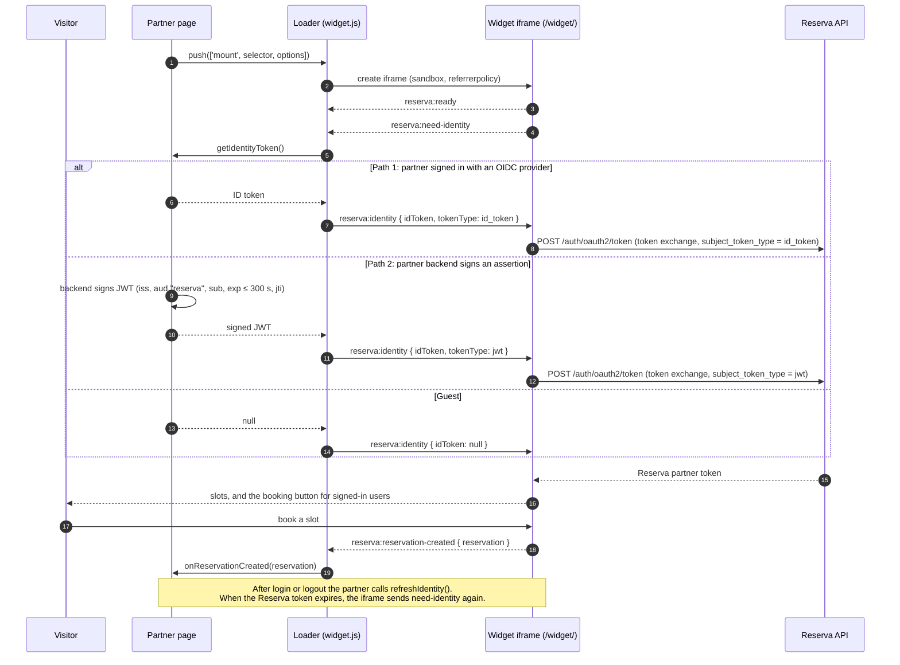

# Widget reference

The Reserva booking widget shows the available time slots of a location on a partner's website and lets
signed-in visitors book them. This page is the reference for embedding it. The identity paths are described
in detail in [partner-integration.md](partner-integration.md).

## How it is delivered

- **`/widget.js`** is the loader. It is a small standalone script without React. It is served from the Reserva
  origin, and the name is a public contract (no hash in the file name). Cache: 5 minutes.
- **`/widget/`** is the iframe application. The loader creates an `<iframe>` pointing at it, with the query
  parameters `clientId`, `locationId`, `theme`, `locale`, `origin` (the partner page origin) and `v` (the
  protocol version, currently `1`).
- Both are produced by the same build of this repository (`yarn build`). See [deployment.md](deployment.md).

The loader is the only part that runs on the partner page. The Reserva token never leaves the iframe.

## Embedding

```html
<div id="reserva-widget"></div>
<script>
  window.ReservaWidget = window.ReservaWidget || [];
  window.ReservaWidget.push([
    'mount',
    '#reserva-widget',
    {
      clientId: '<public client application id>',
      locationId: '<location id>',
      getIdentityToken: () => myAuth.getIdentityToken(),
    },
  ]);
</script>
<script async src="https://<reserva origin>/widget.js"></script>
```

Commands pushed before the script loads are queued and run in order. After the script has loaded, `push`
runs them immediately, so the same snippet works whether the script loads before or after the queue is filled.

## Mount options

Passed as the third element of `['mount', selector, options]`.

| Option                 | Required | Type                                              | Description                                                                                                                                                                  |
| ---------------------- | -------- | ------------------------------------------------- | ---------------------------------------------------------------------------------------------------------------------------------------------------------------------------- |
| `clientId`             | yes      | `string`                                          | Public ID of the partner's client application.                                                                                                                               |
| `locationId`           | yes      | `string`                                          | Location to show and book. It must be in the partner's scope and approved for consent.                                                                                       |
| `getIdentityToken`     | yes      | `() => string \| null \| Promise<string \| null>` | Returns the signed-in user's identity token, or `null` for a guest. Called whenever the widget needs an identity. Must return a fresh token each time.                       |
| `identityTokenType`    | no       | `'id_token' \| 'jwt'`                             | `'id_token'` (default): an OIDC ID token from a trusted issuer. `'jwt'`: an assertion signed by the partner's backend. See [partner-integration.md](partner-integration.md). |
| `theme`                | yes      | `'light' \| 'dark'`                               | Widget theme. There is no default and no `'auto'`: pass the theme of your site. Change it later with `setTheme`.                                                             |
| `locale`               | no       | `'sr' \| 'en'`                                    | Default `'sr'`.                                                                                                                                                              |
| `onReservationCreated` | no       | `(reservation) => void`                           | Called after a reservation is created. See below.                                                                                                                            |
| `onUnavailable`        | no       | `({ reason }) => void`                            | Called when the widget cannot book at this location. See below.                                                                                                              |
| `onSignInRequired`     | no       | `() => void`                                      | Called when a guest clicks "Reserve". Open your sign-in, then call `refreshIdentity`. See below.                                                                             |

If `clientId`, `locationId`, `theme` (`'light'` or `'dark'`) or `getIdentityToken` is missing or invalid, `mount` logs an error and renders nothing.
Callbacks that throw are caught and logged, so they cannot break the loader.

## Commands

| Command                          | Effect                                                                                                                                |
| -------------------------------- | ------------------------------------------------------------------------------------------------------------------------------------- |
| `['mount', selector, options]`   | Renders the iframe into the first element that matches `selector`. Mounting again into the same element replaces the previous widget. |
| `['refreshIdentity', selector?]` | Calls `getIdentityToken()` again and sends the new identity to the widget. Without a selector, it applies to every mounted widget.    |

The same is available as a method: `window.ReservaWidget.refreshIdentity(selector?)`, which returns a promise.

| Command                          | Description                                                                                                                         |
| -------------------------------- | ----------------------------------------------------------------------------------------------------------------------------------- |
| `['setTheme', theme, selector?]` | Switches `'light'` / `'dark'` without a reload; the selected slot is kept. Also `window.ReservaWidget.setTheme(theme, selector?)`. |

The loader delivers it to the iframe as the `reserva:theme` message (`{ v: 1, type: 'reserva:theme', theme }`). An unknown theme is ignored. The iframe never shows a scroll bar: its height follows the content in both directions (`reserva:resize`).

Call `refreshIdentity` after every sign-in and sign-out on your site, for example:

```js
window.ReservaWidget.push(['refreshIdentity']);
```

The Reserva token in the widget lasts about 10 minutes and has no refresh. When it expires, the widget asks
for an identity again on its own, and the loader calls `getIdentityToken()`.

## Events

### `onReservationCreated(reservation)`

```ts
{
  id: string;
  status: 'PENDING_APPROVAL' | 'CONFIRMED' | 'REJECTED' | 'CANCELLED';
  startTime: string; // LocalDateTime
  endTime: string; // LocalDateTime
  locationName: string | null;
}
```

This is the only reservation data that leaves the iframe. It contains no email address, no user ID and no
identity ID.

### `onUnavailable({ reason })`

| `reason`                | Meaning                                                  | Suggested partner action                     |
| ----------------------- | -------------------------------------------------------- | -------------------------------------------- |
| `LOCATION_OUT_OF_SCOPE` | The location does not belong to this partner.            | Show a fallback, for example a phone number. |
| `CONSENT_NOT_APPROVED`  | The business has not approved consent for this location. | Show a fallback.                             |
| `PARTNER_DISABLED`      | A Reserva administrator has disabled the partner.        | Show a fallback.                             |

### `onSignInRequired()`

A guest (`getIdentityToken` returned `null`) can choose a service, a resource and a slot. When they click
"Reserve", the widget remembers the choice, shows "Sign in to confirm your reservation" with a cancel
button, and sends `reserva:sign-in-required`. The loader then calls `onSignInRequired()`.

Open your sign-in flow there. After the user is signed in, call `refreshIdentity()`; the widget receives a
token and completes the remembered reservation by itself, without asking the user to choose again. If the
slot was taken in the meantime, the widget shows an error and refreshes the slots.

`onSignInRequired` is optional. Without it the widget stays in the "sign in on the partner's website" state.

### postMessage protocol additions

| Message                    | Direction       | Payload          | Meaning                                   |
| -------------------------- | --------------- | ---------------- | ----------------------------------------- |
| `reserva:sign-in-required` | iframe → loader | `{ v: 1, type }` | A guest tried to book. Protocol stays v1. |

## Terms of use

Every widget shows a "by Reserva" mark with the Reserva logo at the bottom. It links to the Reserva site
(opens in a new tab) and is part of the iframe, so it is included in the height the widget reports.

- The "by Reserva" mark **must stay visible** in every widget state.
- It is forbidden to cover it, clip it (an iframe height or width smaller than its content, or
  `overflow: hidden` on a parent), make it transparent, or change or remove it in any way.
- Breaking this rule is grounds for removing the partner.

## Size and styling

- The iframe is 100% of its container's width. Its height starts at 420 px and then follows the content
  height that the widget reports. The loader caps the height at 10,000 px.
- Give the container a width, not a fixed height, so the widget can grow to fit its content.
- The iframe is cross-origin, so your CSS cannot reach inside it. Use the `theme` and `locale` options to
  change its appearance.

## Origins and security

- **Partner side:** the partner's `allowed_origins` lists the exact origins that may embed the widget
  (scheme, host and port). The widget sends messages only to a page whose origin is on this list. Otherwise it
  shows the message "This website is not allowed to show the booking widget."
- **Loader side:** the loader accepts messages only from the Reserva origin it was loaded from, and only from
  its own iframe. It sends messages only to that origin. It never uses `'*'`.
- **Iframe attributes:** the loader sets `sandbox="allow-scripts allow-same-origin allow-forms allow-popups allow-popups-to-escape-sandbox allow-downloads"`
  (without `allow-top-navigation`) and `referrerpolicy="strict-origin"`. Do not change them.
- **Reserva side (for operators who host Reserva):** the frontend sends
  `Content-Security-Policy: frame-ancestors <list>` for `/widget/`. The list comes from the runtime variable
  `WIDGET_FRAME_ANCESTORS`. The rest of the application keeps `frame-ancestors 'self'`. Add a partner origin
  there before the widget can be embedded from it.

## Sequence: embedding and sign-in

The diagram shows both identity paths. Path 1 uses an OIDC ID token (`identityTokenType` not set). Path 2
uses a partner-signed JWT (`identityTokenType: 'jwt'`). For a guest, `getIdentityToken` returns `null` on
either path.



## Troubleshooting

| Symptom                                                                      | Likely cause                                                                                                                           |
| ---------------------------------------------------------------------------- | -------------------------------------------------------------------------------------------------------------------------------------- |
| Console: `mount: no element matches "<selector>"`                            | The selector does not match an element that exists when `push` runs.                                                                   |
| Console: `mount: clientId, locationId and getIdentityToken are required`     | One of the three required options is missing or empty.                                                                                 |
| Console: `cannot determine the script origin`                                | The loader script was not loaded from a `src` that contains `widget.js`. Keep the file name unchanged.                                 |
| Console: `getIdentityToken failed`                                           | Your `getIdentityToken` function threw. The widget then treats the visitor as a guest.                                                 |
| Console: `unknown command`                                                   | The first element of a queued command is not `mount`, `refreshIdentity` or `setTheme`.                                                             |
| The widget says "This website is not allowed to show the booking widget."    | Your origin is not in the partner's `allowed_origins`.                                                                                 |
| Visitor sees slots but no booking button                                     | `getIdentityToken` returned `null`, or the token is expired.                                                                           |
| Widget shows a fallback instead of slots                                     | `onUnavailable` was called. Check `reason`.                                                                                            |
| Iframe is blank, and the browser console shows a `frame-ancestors` violation | Operators: the partner origin is missing from `WIDGET_FRAME_ANCESTORS`.                                                                |
| Token exchange returns `invalid_grant`                                       | The assertion was rejected: check the signature, `iss`, `aud`, `exp` (at most 300 s), clock skew (60 s allowed) and that `jti` is new. |
| Token exchange returns `invalid_client`                                      | The partner is unknown or disabled.                                                                                                    |
